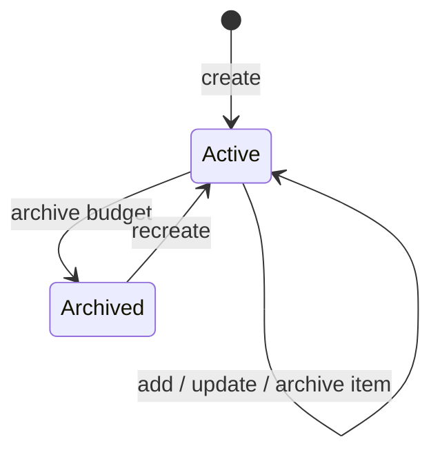

# Authoritative budget commands

Updated: 2026-10-22.

Budget totals and active item counts are now maintained by the authenticated
`mutateBudget` callable in `us-central1` (Node.js 22). Flutter reads budgets and
items from Firestore as before, but sends mutations through `cloud_functions`.
The callable uses the verified Auth UID, not a client-supplied owner. App Check
enforcement is unchanged. The production rollout status is recorded below.

## Rollout status — 2026-10-22

The targeted deployment created the Node.js 22 Gen 2 callable, but Firebase CLI
exited with code 2 when setting the Cloud Run invoker policy. Google returned
`FAILED_PRECONDITION`: policy members do not belong to a permitted customer.
This is compatible with domain-restricted sharing, but the effective organization
constraints have not been inspected; this error alone does not identify the
effective organization constraint.

The initial unauthenticated HTTP probe returned infrastructure HTTP 403. After
explicit operator approval, authenticated gcloud updated only `mutatebudget` with
`--no-invoker-iam-check`. Read-back confirmed the service is ready and its
`run.googleapis.com/invoker-iam-disabled` annotation is `true`; its IAM policy
has no bindings. The same probe now returns HTTP 401 and callable
`UNAUTHENTICATED` / `budget-session-expired`, confirming that requests reach the
Firebase Auth guard. No organization-wide policy or other service was changed.

The updated signed client was installed on the physical iPhone using the real
local Firebase configuration. Flutter connected to its VM service, the inspector
confirmed `CanonicalHomeScreen` (not login/session recovery), hot reload passed,
and runtime error inspection found no errors. No real financial test records
have been written. This startup smoke does not constitute a production budget
mutation test; financial workflows were exercised with synthetic Emulator data.

After this gate passed, `firestore:rules` was deployed successfully to
`lumiomoney`. Read-back matched the local source (SHA-256
`3a4b6edcfe57f490fc29b6378bc8b41cc8ef0106584c62f12c899661a0e2a2c6`).
The previous rules snapshot SHA-256 is
`15a93f2dca69c9a733397b5b31cc849223d90736f4e9309fbf3c654f3273f944`.
Older clients can no longer modify budgets directly; they require the updated
callable-enabled client. This budget rollout did not deploy `processOperation`;
an explicitly authorized subsequent deployment is recorded in
[projection deployment status](projection-audit.md#deployment-status).

Changing service IAM access requires an explicit operational decision. Do not
weaken organization-wide policy as a workaround. Google's
[public Cloud Run access guidance](https://docs.cloud.google.com/run/docs/authenticating/public)
describes the service-specific Invoker IAM check option used here; Firebase Auth
remains mandatory inside the callable even though HTTP invocation is public.

For this service, verify this setting after every future Functions deployment;
do not assume a Firebase CLI deployment preserves it or completes its invoker
policy step. With an authorized gcloud identity, the scoped commands are:

```bash
gcloud run services update mutatebudget --region=us-central1 --project=lumiomoney --no-invoker-iam-check --quiet
# Re-enable the transport IAM guard if operational rollback is needed:
gcloud run services update mutatebudget --region=us-central1 --project=lumiomoney --invoker-iam-check --quiet
```

Re-enabling the guard blocks normal mobile callable requests and must be
coordinated with client/rules rollback. Never remove the callable's Firebase
Auth check to resolve a transport error.

Verification completed locally:

- `flutter analyze`: clean; Flutter suite: 165 passing tests.
- Budget transactions: 8 passing; callable/Auth Emulator: 1 passing;
  Firestore rules: 9 passing.
- Projection transaction/audit suite: 17 passing; real trigger: 1 passing;
  pure projection tests: 3 passing. The projection trigger was deployed only in
  the separately authorized follow-up recorded in the projection runbook.
- Budget creation E2E passed on iOS Simulator; item-management E2E passed on
  Android Emulator, including archive/recreate and preservation of linked history.
  A separate iOS item-management run had native initialization timeouts and is
  not qualified as passing.
- Android debug, iOS Simulator and signed physical-device iOS debug builds passed.
  Android release packaging remains blocked by the missing release keystore.
  Physical-device installation/startup and hot reload passed; hosted CI remains
  unverified.

## Budget lifecycle



| Transition | Guard and atomic effect | Failure/client behavior |
| --- | --- | --- |
| Create | Authenticated owner, compatible category, valid active items; create parent/items/receipt | Conflict if already active; preserve draft |
| Change active items | Owner and active parent; recompute total/count with receipt | Invalid input or last-item removal writes nothing |
| Archive budget | Owner; archive parent with receipt, retain item history | Error preserves current screen for retry |
| Recreate | Owner and archived parent; archive previous active items, create new items, recompute aggregates | Linked history remains; no client-side offline success |
| Replay command | Same owner, request ID and normalized payload | Return saved result; changed payload is a conflict |

See [server implementation](../functions/src/budget_commands.ts),
[transaction tests](../functions/test/budget_commands_test.mjs) and
[callable tests](../functions/test/budget_callable_test.mjs).

## Command contract

Every command requires `requestId` (8–128 alphanumeric, underscore or hyphen
characters) and `action`. Unknown input fields are rejected, including owner,
planned total, item count, actual amount and timestamps.

| Action | Payload |
| --- | --- |
| `create` | `categoryId`, `flowType`, `monthKey`, `currency`, `items` |
| `addItem` | `budgetId`, `item` |
| `updateItem` | `budgetId`, `itemId`, `item` |
| `archiveItem` | `budgetId`, `itemId` |
| `archiveBudget` | `budgetId` |

Each input item has `description`, `amountMinor` and `dayOfMonth`. Descriptions
are trimmed and limited to 200 UTF-16 code units. Dates respect the selected
month, including leap years. Individual amounts and the total use the existing
nominal maximum of 1,000,000,000 currency units and safe integer minor units.
The create request accepts at most 1,000 items as a request-size safeguard;
Firestore transaction limits can reject an oversized command atomically. This
does not add a limit on a budget's lifetime archived history.

The result contains `budget` (canonical identity, planned amount, count and
status) and an optional changed `item`. No parent/item write happens until
all reads and validations have completed. Active items, including legacy items
without a status, are the source for the total and count. Existing incorrect
aggregates are recalculated on the affected budget; invalid item records fail
the whole command instead of being silently omitted.

Creation keeps the deterministic budget ID. Creating an existing active budget
conflicts. Recreating an archived budget archives its previous active items,
creates new items, and preserves old item IDs, actual amounts and operation
links. Editing and archiving never accept a client-provided actual amount.
Archiving the last active item is refused; archiving the whole budget remains
available. Archiving a budget preserves its items and planned snapshot until
the budget is recreated.

## Retry and UI behavior

`users/{uid}/budgetCommands/{requestId}` stores a normalized command digest,
its result and creation time in the same transaction as the mutation. A retry
returns the saved result; a different command cannot reuse the request ID.
Receipts have no automatic expiration, because deleting them would remove
replay protection. Item IDs derive from the request ID, so transaction retries
cannot create different documents.

The repository accepts an optional request ID and preserves `Either` results.
The actions controller retains a secure generated ID for a failed command and
reuses it for an identical retry within the current session. Success clears it
so a later intentional addition can use the same values. This is not an offline
budget queue and does not auto-replay after app restart. A connection error
keeps the form visible and does not promise background synchronization.
Changing a failed draft starts a different command. Confirmed server responses
keep the existing immediate budget-list feedback while streams catch up.

Errors expose allowlisted issue codes, mapped to localized ES/EN/PT messages.
Raw SDK messages, descriptions and other financial data are not logged.

## Checks

```bash
npm --prefix functions run build
bash tool/run_budget_command_tests.sh
./tool/run_rules_tests.sh
bash tool/run_projection_tests.sh
flutter analyze
flutter test
```

Budget tests first run transactions with Firestore alone, then real callable
requests with Auth/Firestore/Functions. They cover replay, concurrent additions
and removals, total recomputation, archived history, invalid inputs and owner
scoping. Rules tests reject even coherent direct client writes and protect
command receipts from all clients. All runners pin `demo-clearbudget`.

Flutter E2E uses `tool/run_emulator_e2e.sh` with
`E2E_TEST_FILE=integration_test/budget_creation_flow_test.dart` or
`integration_test/budget_item_management_flow_test.dart`. For iOS, also set
`E2E_PLATFORM=ios` and pass a simulator/device ID. Production records must never
be used as automated financial fixtures.

## Coordinated deployment

The previous deployed rules source is backed up locally in the Git-ignored
`.local/firebase-deployments/lumiomoney-20261022-before.rules`. Keep its checksum
and the deployment outcome with the local handoff. These are operational files,
not repository credentials or financial exports.

Deployment order is mandatory:

1. Complete local tests and applicable native builds.
2. Deploy only `functions:mutateBudget` to the explicit project `lumiomoney`.
   Check function state and an unauthenticated request returning
   `UNAUTHENTICATED`, without writing real financial data.
3. Validate the updated Flutter client with Emulator and install it on the
   available iPhone. Verify its startup using the real local Firebase config.
4. Deploy only `firestore:rules` to `lumiomoney`, then read back and compare the
   deployed source. If the client cannot be prepared/validated, stop before
   closing direct permissions and record the blocker.

The final rules allow owner reads but deny all client writes to budgets/items
and all client access to receipts. Older clients will therefore lose budget
mutation capability. The new callable must remain deployed when using these
rules. Reverting the client requires restoring the backed-up previous rules as
a coordinated rollback; never delete budgets, items, operations or receipts
to roll back code. Keep this budget rollout separate from `processOperation`
deployments. It does not run a historical repair or publish an app-store release.

With local Firebase CLI authentication completed, use explicit project/targets:

```bash
npm --prefix functions run build
npx -y firebase-tools@latest deploy --project lumiomoney --only functions:mutateBudget --non-interactive
# Only after the updated client has passed its rollout gate:
npx -y firebase-tools@latest deploy --project lumiomoney --only firestore:rules --non-interactive
```

Keep the previous rules snapshot outside Git. If rollback is needed, deploy
that snapshot using a separate temporary Firebase configuration (or an isolated
checkout), so restoring remote permissions does not overwrite the current local
rules source. Revert/replace the client only in coordination with that rules
rollback. Do not erase server command receipts to retry an uncertain request.
