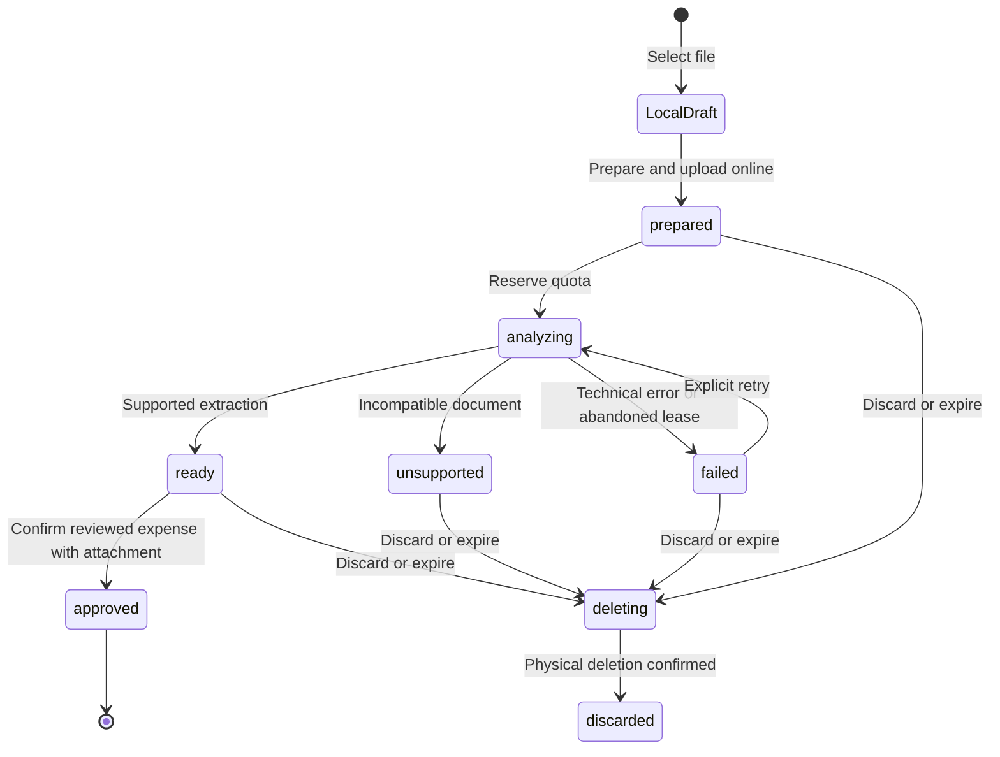

# Receipt imports and account identification

This page describes the working-tree implementation. Release evidence is tracked in [receipt qualification](document-import-qualification.md); a successful local test is not a production deployment.

## Product and ownership

Registered users can open **Registrar → Desde foto o archivo**, choose a camera image, gallery image or PDF, and review one expense or credit-card purchase. The reviewed operation must be confirmed as already performed. Every imported operation retains its receipt; removing an attachment later does not reverse the operation, and reversing an operation does not delete its receipt.

`FinanceAccount` preserves account IDs, nature, currency and balances. Optional `institutionName`, `institutionCountryCode` and `accountLastFour` identify money accounts. Credit cards continue to use their existing `lastFour` for the card. `PaymentInstrument` represents a linked debit card with no independent balance; its server command validates owner, generation, account, expected version and idempotent request. Archived accounts/instruments are excluded from account suggestions.

An account suggestion requires a unique currency/type/institution/suffix match. Model-generated account IDs are ignored. Only active expense categories can be suggested. Missing fields remain unset for review. Statements, multiple transactions, income, transfers and debt payments are outside the automatic-import scope.

## Lifecycle and contracts

The local draft is separate from the server proposal. Selecting a file while offline never reserves analysis quota or writes a financial operation. Native drafts live in app-private storage; web drafts use IndexedDB. Both are associated with UID and financial generation. Reopening does not automatically analyze a document.

| State / action | Guard | Result and retry behavior |
| --- | --- | --- |
| Local selection | Registered session, supported local file | Private draft; offline explanation; no automatic upload |
| `mutateDocumentImport.prepare` | Auth + App Check, current generation, enabled policy, valid size/type/hash, temporary/storage reservation | Stable import ID and immutable private Storage path; identical retries reuse it |
| `analyze` | Current generation, uploaded file/hash, real image decoding or valid unencrypted PDF of at most three pages | One commercial reservation; one explicit provider attempt; a concurrent caller receives current state |
| Extraction succeeds | Same attempt, generation and lease | `ready` or `unsupported`; either consumes one user analysis |
| Technical failure | Charged reservation | Refund once; record technical attempt with unknown cost if usage is unavailable |
| Process interrupted | Lease expires | Hourly cleanup releases the outside-user reservation, even after financial reset |
| Save | `ready`, exact proposal version, explicit performed confirmation, file still retained, normal financial validation | Attachment, source deduplication marker, operation and financial projections committed together |
| Discard / expire | Not approved and no live analysis lease | Claim deletion, delete file, release reservations; late uploads are deleted rather than resurrected |
| Delete attachment | Owner/current generation | Delete physical object before releasing bytes; keep the financial operation |
| Reset financial data | Existing reset command | Remove proposals, instruments, references and older-generation files; retain resource quotas/history |

The terminal `duplicate` response points at an operation already created from an identical source hash for that UID/generation. Approximate same-account/amount/currency/date matches require a separate explicit decision. Edits retain attachment identity, including corrected credit-card purchases.

`mutateOperation` creates imported bank expenses; `mutateDebt.purchase` creates imported card purchases. Neither receives another user's UID. Both validate the proposal and apply attachment writes inside the existing financial transaction. A lost response reuses `doc_{importId}`. Financial drafts are not placed in the offline queue by this flow.

## Storage and security

Sources are stored at `users/{uid}/documentImports/{generation}/{importId}/source`. Rules allow one owner upload only after a server reservation, with exact MIME/size, current generation and expiration. Direct reads, replacements and deletion are denied. Legacy receipt uploads are disabled so they cannot bypass quotas. The server revokes Firebase bearer download tokens before analysis; retained files are served only through the authenticated metered attachment endpoint.

JPEG/PNG/WebP images are limited to 5 MB and decoded with a 40-million-pixel ceiling. PDFs are limited to 10 MB, three pages and no password. The client optimizes images and converts supported HEIC inputs to JPEG. The original uploaded source hash is verified before provider calls. Documents are treated as inert data, never instructions or links to execute.

Provider calls use server-side Vertex AI, `gemini-3.8-flash` (configurable through `DOCUMENT_AI_MODEL`) and structured output. SDK automatic retries are disabled: each application retry is a separately metered attempt. Production endpoints require Firebase Auth and App Check. Android Play Integrity and iOS App Attest configurations are provisioned; debug clients require their own registered debug token. Web needs `APP_CHECK_WEB_SITE_KEY` configured before protected features can be used.

## Limits, costs and operations

See [resource accounting](resource-usage.md) for quota semantics, retention, billing comparison and rollout. See [privacy inventory](privacy-data-inventory.md) for processing and deletion responsibilities.

Useful routes: `/document-imports/new`, `/document-imports/:id/review`, `/settings/usage`, `/attachments/:id`, `/accounts/:id/instruments`.

Tests: `document_imports_test.mjs`, `document_rules_test.mjs`, `resource_costs_test.mjs`, `document_import_controller_test.dart`, `document_ui_test.dart`, and `integration_test/document_import_flow_test.dart`. The E2E injects only file selection/connectivity and the external AI fixture; Auth, Storage, Firestore, Functions, forms and financial projections run in Emulator.
