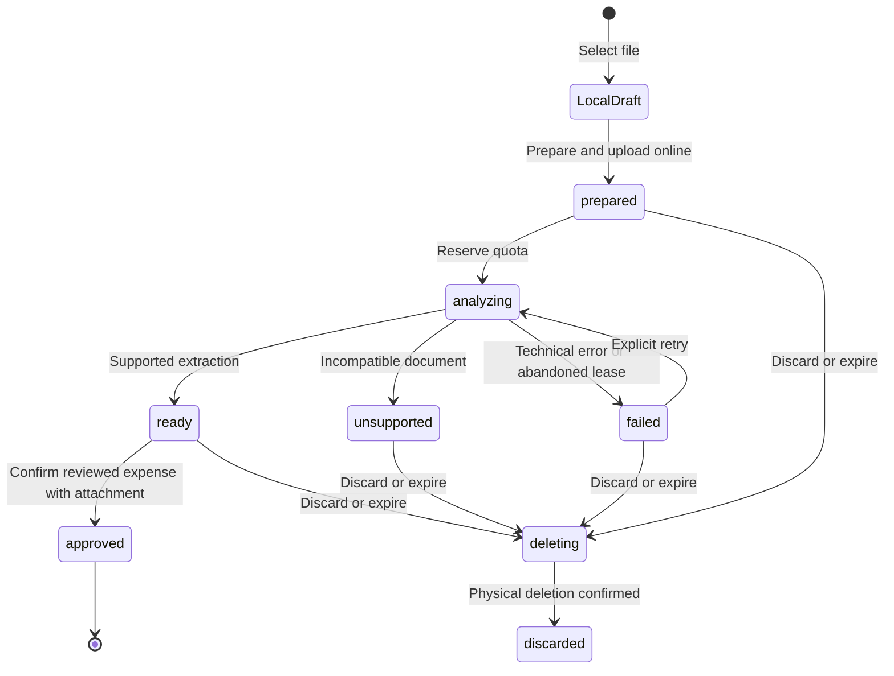

# Receipt imports and account identification

This page describes the working-tree implementation. Release evidence is tracked in [receipt qualification](document-import-qualification.md); a successful local test is not a production deployment.

## Product and ownership

Registered users can open **Registrar → Desde foto o archivo**, choose a camera image, gallery image or PDF, and review one expense or credit-card purchase. The reviewed operation must be confirmed as already performed. Every imported operation retains its receipt; removing an attachment later does not reverse the operation, and reversing an operation does not delete its receipt.

`FinanceAccount` preserves account IDs, nature, currency and balances. Optional `institutionName`, `institutionCountryCode` and `accountLastFour` identify money accounts. Credit cards continue to use their existing `lastFour` for the card. `PaymentInstrument` represents a linked debit card with no independent balance; its server command validates owner, generation, account, expected version and idempotent request. Archived accounts/instruments are excluded from account suggestions.

An account suggestion requires a unique currency/type/institution/suffix match. Model-generated account IDs are ignored. Only active expense categories can be suggested. Missing fields remain unset for review. Statements, multiple transactions, income, clearly identified transfers between the user's own accounts and debt payments are outside the automatic-import scope. A merchant purchase paid by bank transfer is an expense candidate: the payment rail alone must not reject it. If its purpose/category is unclear, the category remains unset and the user must review and explicitly confirm that the payment represents an expense before posting.

## Field-level review

`mapDocumentImport` preserves server warning codes as typed `DocumentReviewField` values. `DocumentSuggestion.statusFor` and `DocumentFieldReviewHint` distinguish **Suggested from the receipt**, **Review** and **Your choice**. Missing or unavailable values remain reviewable, including accounts/categories archived after extraction. Unknown future warning codes are tolerated; older responses without warnings remain compatible. These labels identify origin/attention, not confidence percentages or a guarantee of correctness.

The canonical review form shows hints for amount, currency, account, category, date and a nonempty optional description. Currency remains visible from the extraction before an account is selected. Choosing a different account currency shows an explicit mismatch explanation; no currency conversion is performed. Existing validators and the performed-expense confirmation still control submission.

Manual field-origin markers are stored only in the private draft's `review.editedFields`. Saving merges review metadata rather than dropping existing draft flags. Reopening preserves manual values and their origin, including older drafts that lack explicit origin markers. The stable import/command identity and original generation remain unchanged. Normal income/expense forms and historical operations do not acquire import hints.

The form retries initial draft loading when authentication becomes available after its first frame. Draft persistence uses the repository/owner captured while mounted, not provider reads during disposal. This avoids an indefinitely loading review and unsafe provider access when leaving the form. Both are covered by the imported-form widget tests, including offline submission and reopening.

Extracted dates must be real calendar dates within **2000–2100**, matching the existing date picker. `validateExtraction` omits other dates and emits `date-review`; the client mapper also guards older stored responses. An invalid restored draft date does not become a confirmed date merely because the screen uses today as its picker starting point. No historical financial records are migrated or reclassified.

Strings and hints are localized in es/en/pt, wrap with enlarged text and inherit theme colors. The hints are descriptive text with decorative icons, not additional required dialogs. Tests live in `test/features/document_imports/document_field_review_test.dart`; Android integration assertions check both suggested image values and missing/manual PDF account selection.

## Lifecycle and contracts

The local draft is separate from the server proposal. Selecting a file while offline never reserves analysis quota or writes a financial operation. Native drafts live in app-private storage; web drafts use IndexedDB. Both are associated with UID and financial generation. Reopening does not automatically analyze a document.



| State / action | Guard | Result and retry behavior |
| --- | --- | --- |
| Local selection | Registered session, supported local file | Private draft; offline explanation; no automatic upload |
| `mutateDocumentImport.prepare` | Auth + App Check, current generation, enabled policy, valid size/type/hash, temporary/storage reservation | Stable import ID and immutable private Storage path; identical retries reuse it |
| `analyze` | Current generation, uploaded file/hash, real image decoding or valid unencrypted PDF of at most three pages | One commercial reservation; one explicit provider attempt; a concurrent caller receives current state |
| Extraction succeeds | Same attempt, generation and lease | `ready` or `unsupported`; either consumes one user analysis |
| Technical failure | Charged reservation | Refund once; record technical attempt with unknown cost if usage is unavailable |
| Process interrupted | Lease expires | Hourly cleanup releases the outside-user reservation, even after financial reset |
| Save | `ready`, exact proposal version, explicit performed confirmation, file still retained, normal financial validation | Attachment, source deduplication marker, operation and financial projections committed together |
| Discard / expire | Not approved and no live analysis lease | Claim deletion, delete file, release reservations; late uploads are deleted rather than resurrected |
| Delete attachment | Owner/current generation | Delete physical object before releasing bytes; keep the financial operation |
| Reset financial data | Existing reset command | Remove proposals, instruments, references and older-generation files; retain resource quotas/history |

The terminal `duplicate` response points at an operation already created from an identical source hash for that UID/generation. Approximate same-account/amount/currency/date matches require a separate explicit decision. Edits retain attachment identity, including corrected credit-card purchases.

`mutateOperation` creates imported bank expenses; `mutateDebt.purchase` creates imported card purchases. Neither receives another user's UID. Both validate the proposal and apply attachment writes inside the existing financial transaction. A lost response reuses `doc_{importId}`. Financial drafts are not placed in the offline queue by this flow.

## Storage and security

Sources are stored at `users/{uid}/documentImports/{generation}/{importId}/source`. Rules allow one owner upload only after a server reservation, with exact MIME/size, current generation and expiration. Direct reads, replacements and deletion are denied. Legacy receipt uploads are disabled so they cannot bypass quotas. The server revokes Firebase bearer download tokens before analysis; retained files are served only through the authenticated metered attachment endpoint.

JPEG/PNG/WebP images are limited to 5 MB and decoded with a 40-million-pixel ceiling. PDFs are limited to 10 MB, three pages and no password. The client optimizes images and converts supported HEIC inputs to JPEG. The original uploaded source hash is verified before provider calls. Documents are treated as inert data, never instructions or links to execute.

Provider calls use server-side Vertex AI, `gemini-3.8-flash` (configurable through `DOCUMENT_AI_MODEL`) and structured output. SDK automatic retries are disabled: each application retry is a separately metered attempt. Production endpoints require Firebase Auth and App Check. Android Play Integrity and iOS App Attest configurations are provisioned; debug clients require their own registered debug token. Web needs `APP_CHECK_WEB_SITE_KEY` configured before protected features can be used.

## Limits, costs and operations

See [resource accounting](resource-usage.md) for quota semantics, retention, billing comparison and rollout. See [privacy inventory](privacy-data-inventory.md) for processing and deletion responsibilities.

Useful routes: `/document-imports/new`, `/document-imports/:id/review`, `/settings/usage`, `/attachments/:id`, `/accounts/:id/instruments`.

Tests: `document_imports_test.mjs`, `document_rules_test.mjs`, `resource_costs_test.mjs`, `document_import_controller_test.dart`, `document_ui_test.dart`, and `integration_test/document_import_flow_test.dart`. The E2E injects only file selection/connectivity and the external AI fixture; Auth, Storage, Firestore, Functions, forms and financial projections run in Emulator.


## Repeatable regression checks

`bash tool/run_document_tests.sh` runs document/resource and access-rule checks in `demo-clearbudget`. `bash tool/run_document_e2e.sh` runs the image → PDF → exact-source duplicate route on Android Emulator, including offline draft retention, manual review, attachment bytes and financial invariants. Set `E2E_PLATFORM=ios` and `E2E_DEVICE` to a Simulator UUID for the corresponding iOS run. The fixture varies by MIME type only inside the Functions Emulator; production still calls the configured Vertex provider. CI runs both document suites and uploads synthetic screenshots/results separately from physical-device evidence.

For real Android QA, `bash tool/run_android_qa.sh <device-id>` verifies a physical authorized device and the `lumiomoney` native/Dart configuration, then starts the debug-only Driver entry point. Sign in on the phone; never put passwords or App Check debug tokens in logs committed to the repository. Record protected-access checks separately from file analysis and persisted financial results.

Native sharing and compact editing attachments are described in [receipt sharing](shared-receipts.md). They reuse the same import/approval contracts; sharing itself does not analyze or post a movement.


## Repeatable synthetic provider qualification

`functions/tool/qualify_receipts.mjs` is an explicit, billable provider benchmark, not an application E2E suite. It uses the same `analyzeReceipt` and `validateExtraction` as the server. It never creates users, imports, attachments or financial operations, and never spends a user's commercial analysis quota. Provider charges belong to shared qualification; do not attribute them to the QA UID.

The `multiformat-v1` corpus contains 30 unique synthetic cases: ten each in es/en/pt and ten each in PDF/PNG/JPEG. Cases cover total versus subtotal/tax/tip/tender/change, USD/EUR minor units, merchant payments by transfer, missing dates/totals, own-account transfers, multi-transaction statements and untrusted instructions embedded in a receipt. These are clear generated documents, not a representative sample of customer photos. HEIC conversion, blur/rotation and platform pickers require their separate tests.

From the repository root:

```bash
npm --prefix functions run build
node --test functions/test/receipt_evaluation_test.mjs
cd functions
GCLOUD_PROJECT=lumiomoney node tool/qualify_receipts.mjs --live \
  --output=../artifacts/document-imports/provider-qualification-20261102.json
```

The operator must deliberately choose live mode and the target project, with ADC available. Emulator environment variables are rejected. The output is private/ignored; use a new output filename for a deliberate fresh evaluation. Reusing a matching report resumes only cases not yet attempted. Completed and failed attempts are not retried. An exclusive lock prevents concurrent runners; after a hard termination, inspect the process before manually removing its stale lock. An in-flight checkpoint is treated as interrupted with unknown consumption on resume, never automatically repeated.

Results retain fixture ID/hash, pass/fail per expected field, category/account checks, model, sanitized error code, reported token units and latency. They exclude source bytes, raw extraction text and credentials. Missing fields are assessed as omissions; unsupported documents are assessed for rejection, not invented transaction fields. Financially normalized field correctness is distinct from suggestion/category accuracy and technical availability.

Costs use the existing versioned, time-bounded resource tariffs and report only the known token-cost subtotal. Missing usage or tariffs remain incomplete, including technical failures. The subtotal excludes networking, shared compute, free tiers, credits and invoice adjustments. The benchmark is not evidence of complete per-user cost attribution or production receipt accuracy. The report must distinguish responses, exact responses, failed attempts and unfinished evaluations.

`tool/run_document_tests.sh` includes deterministic benchmark tests before the Emulator suite; those tests inject a fake provider and never make live calls. No live benchmark runs in CI.


## Analysis waits and retryable failures

The provider model, prompt and existing 90-second SDK timeout remain unchanged. A delayed result is not a confirmed failure: the UI retains its progress indicator and, after 15 seconds, explains that the receipt is saved and does not need resubmission. This display timer never calls the provider, cancels a request or initiates a retry. It is cancelled when the progress widget is disposed. This is wait-state guidance, not a measured latency optimization.

`documentAnalysisIssue` maps provider HTTP 429/503 to `document-service-busy`, HTTP 408/504 or SDK abort/timeout to `document-analysis-timeout`, and other failures to `document-analysis-failed`. Only these bounded reasons are persisted as the failed import's optional `issue` and returned by the callable. The next claimed attempt and successful completion remove the previous issue. The Flutter mapper accepts only known reasons on a failed source, so reopened drafts can explain the problem without exposing provider text. Older imports without this field retain compatibility.

Each technical failure retains one per-user AI attempt/failure event with a bounded `failureKind`; unknown provider cost remains pending. The existing reservation transaction releases commercial quota once. Retrying preserves the import ID, source file, generation and local review metadata. It checks the stored server state before analysis; an already-ready proposal is reused and an unexpired analyzing lease is not claimed twice. A completed server snapshot also clears a previous local error without issuing another analysis request. There is no automatic model retry.

A client callable `deadline-exceeded` is different: it maps to `document-response-timeout`, explains that the server result is unconfirmed and asks for an explicit retry to check status. It does not claim that analysis failed or locally refund a server reservation. Actual network/offline handling remains separate. The 180-second callable/client request limits and 150-second analysis lease remain unchanged.

Busy, provider-timeout, failed-analysis, unconfirmed-response and long-wait messages are localized in es/en/pt. The normal review and performed-expense confirmation still apply before any financial effect. The emulator-only analyzer fixture supports synthetic 429/504 injection; this branch is unavailable in the real runtime.
