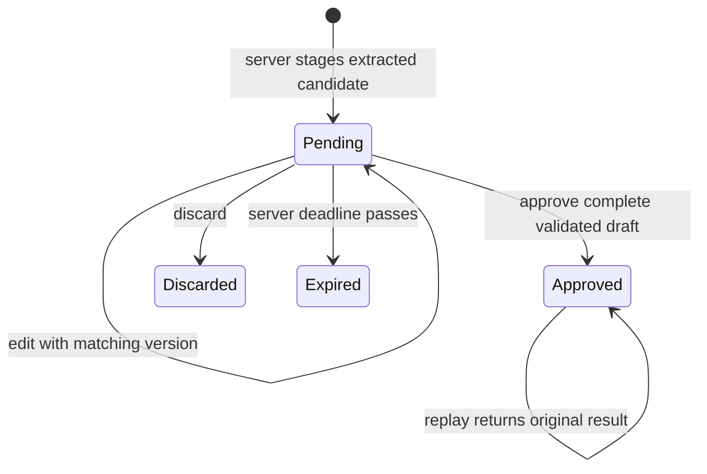

# Assisted email imports — backend foundation

## Current status and boundaries

This is a **partial implementation**, not a connected Gmail feature. The current
working tree preserves the earlier Coach and Activity changes. This delivery
adds deterministic extraction and a server-side review/approval boundary; it
does not expose import screens or read a mailbox.

Implemented entry points in `functions/src/index.ts`:

- `mutateEmailImport`: authenticated, pilot-gated edit/approve/discard commands.
- `listEmailImports`: authenticated, pilot-gated pagination of unresolved
  candidates through callable responses, not Firestore client reads.

`GMAIL_IMPORT_PILOT_UIDS_JSON` defaults to `[]`. An invalid JSON value or an
invalid list also denies access. The Firebase Auth UID is authoritative;
clients cannot specify a different owner. The parameter is operator-managed,
not a profile field. Enrollment alone does **not** enable Gmail access: the
OAuth/search pipeline below is still absent.

## Verified extraction formats

`functions/src/bank_email_parser.ts:parseBankEmail` recognizes three bounded
Colombian templates:

| Format | Result |
| --- | --- |
| Bancolombia `Compraste ... T.Deb` | Expense suggestion and debit-card suffix hint; never an account ID |
| Davivienda `Descuento Compra con llave` | Expense suggestion |
| Davivienda `Abono Transferencia` | Amount/date suggestion; type must be reviewed, not assumed income |

Only the sender addresses observed in the supplied examples are recognized.
Sender matching is not proof of authenticity. No raw Gmail authentication
headers were provided; extraction retains an authentication warning by default.
Account and category selection remain mandatory. There is no automatic
categorization, association persistence or financial approval in the parser.

These specific templates express Colombian pesos and Colombia local time
(`UTC-05:00`). COP values follow the app's existing zero-decimal minor-unit
convention. Nonzero cent fractions, invalid groups, overflow, invalid/future
dates and missing fields need correction; arrival time is never substituted.
Unknown templates, multiple transactions, rejected/reversed transactions,
withdrawals and credit-card movements are not guessed.

HTML is parsed inertly with `htmlparser2`: no rendering, JavaScript, links,
network calls or attachment downloads. Saved Outlook pages isolate the selected
`UniqueMessageBody` so inbox previews are not imported as additional movements.
An Outlook export containing only an inbox list is unsupported.

The three complete user-provided HTML bodies were inspected locally on
2026-10-22. Both purchase formats were recognized; the transfer credit required
type review. The fourth export lacked a selected message body. Originals remain
outside the repository. The eight parser tests use manually synthesized text
with unrelated dates, amounts, merchants and card digits, not copied originals.

## Candidate lifecycle and financial integrity

`functions/src/email_imports.ts` owns `stageEmailImportCandidate`,
`executeEmailImportCommand`, and `listEmailImportCandidates`. Staging is an
internal function, deliberately **not** a client ingestion endpoint.

The following diagram describes effective eligibility; expiration is a guard,
not a completed retention/deletion job.



| Transition | Guards and side effects |
| --- | --- |
| Stage → pending | Stable SHA-256 mailbox/message identity; repeats preserve corrections and terminal markers; no financial writes |
| Pending → edited | Expected version matches; complete typed draft; version increments; no financial writes |
| Pending → approved | Not expired, active compatible accounts, category type, monetary/date bounds; canonical operation, ledger entries, source/reference markers and receipt commit together |
| Pending → discarded | Expected version matches; evidence/draft removed; no financial writes |
| Pending → effectively expired | Deadline is 30 days after staging; listing hides it and approval rejects it |
| Approved → replay | Matching normalized draft returns the original operation ID, even if that operation was later deleted; no recreation |

`requestId` is stable across a command retry. Reusing it with other content is
a conflict. Candidate versions prevent stale edits. Source/reference markers
prevent hard duplicates, while approximate matches against current confirmed
operations in a ±24-hour window require an explicit duplicate-review flag.
If the window contains over 200 operations, review is required conservatively.
This heuristic is not a guarantee against all manually entered duplicates.

Approval creates the existing canonical operation and both the account-wide and
nested ledger entries. It does not write balances or summaries. The existing
`processOperation` trigger remains responsible for eventual, idempotent
projections. The operation's month uses the profile time zone, not email arrival
time. Imported operations are compatible with the existing projection audit.

Transfers require two different active accounts in the same currency and
produce paired opposite entries. There are no implicit budget links, currency
conversions or credit-card liability semantics in this slice.

## Privacy, permissions and retention limits

The implemented collections under `users/{uid}` are server-only:

- `emailImportCandidates`: versioned draft, minimized evidence and deadline.
- `emailImportCommands`: command digest and stable result; no draft/body.
- `emailImportSources` / `emailImportReferences`: minimal deduplication markers.
- `emailImportCredentials`: reserved private boundary; no real credentials
  are stored by this implementation.

Firestore clients, including the owner, cannot read or modify these collections.
Callable responses prevent evidence from entering the default persistent
Firestore client cache. Errors are technical codes, without raw exceptions or
request payloads. No email or financial data is logged by the new code.

Approval/discard removes the candidate draft and evidence. **Automatic deletion
of expired pending evidence is not implemented yet**; no live ingestion is
enabled until cleanup, OAuth, KMS and disconnect deletion are delivered.
The current code must not be represented as a complete 30-day retention system.

## Verification and operations

Run only against the reserved synthetic project:

```sh
bash tool/run_email_import_tests.sh
```

The runner builds TypeScript, starts Firestore Emulator for parser, approval,
projection-store, audit and rule tests, then starts Auth/Firestore/Functions
Emulator for real callable rejection and trigger execution. CI invokes it in
`.github/workflows/flutter.yml`. It does not connect to Gmail or use real
financial records.

Evidence on 2026-10-22:

- TypeScript build passed.
- 39 parser/persistence/projection/audit tests and 17 rules tests passed.
- Two Auth/Firestore/Functions tests passed (callable gates and actual trigger).
- `flutter analyze` found no issues; all 289 existing Flutter tests passed.
- Local Node is 26, whereas the deployment runtime remains Node 22. Emulator
  results must not be described as tests on the Node 22 production runtime.
- `npm audit` reports pre-existing Firebase/transitive advisories. Its latest
  check reported 13 (five high, eight moderate); affected package versions are
  unchanged from HEAD, and `htmlparser2` was not reported. No forced major
  dependency upgrades were performed. Review advisories before opening Gmail.
- The three existing pure projection tests also passed via
  `npm --prefix functions run test:projections`.

Deployment is limited to the two new callables and rules, without redeploying
`processOperation`, budgets or balance adjustments:

```sh
npx -y firebase-tools@latest deploy \
  --only functions:mutateEmailImport,functions:listEmailImports,firestore:rules \
  --project lumiomoney --non-interactive
```

On 2026-10-22, both functions were created and verified `ACTIVE` with runtime
`nodejs22` and `GMAIL_IMPORT_PILOT_UIDS_JSON=[]`. The published rules source
matched the local file exactly, retaining Coach rules. Two preparation attempts
stopped before publishing because the CLI required an explicit dotenv value,
even with a declared parameter default. The final attempt used the ignored
`functions/.env.lumiomoney` file containing only the empty pilot list.

The CLI then exited 2 because it could not assign the Cloud Run invoker IAM
policy. The function code was active, but requests initially returned an
infrastructure HTML 403. After checking that the existing `mutateBudget` service
uses the same pattern, the invoker IAM check was disabled **only** on the two
new services. Firebase Auth checks inside the callables were not disabled:

```sh
gcloud run services update mutateemailimport --region us-central1 \
  --project lumiomoney --no-invoker-iam-check --quiet
gcloud run services update listemailimports --region us-central1 \
  --project lumiomoney --no-invoker-iam-check --quiet
```

Both updates exited 0 and service metadata confirmed
`run.googleapis.com/invoker-iam-disabled=true`. Actual unauthenticated HTTPS
POSTs to both Cloud Functions URLs returned HTTP 401 with callable JSON issue
`import-session-expired`, not an infrastructure error. These probes did not
create Auth users, candidates or financial records. No authenticated real-user
approval or Gmail access was tested. A future deployment must recheck invoker
behavior rather than treating the CLI upload result alone as availability.

The pre-deployment rules backup is ignored by Git at
`.local/firebase-deployments/gmail-rules-before.rules`. Runtime parameter files
`functions/.env*` are also ignored.

## Remaining delivery and external prerequisites

1. Create/configure a Google OAuth client, consent screen and test users. User
   confirmed no OAuth client exists yet. Do not send client secrets in chat.
2. Implement OAuth state/callback, Secret Manager configuration, KMS token
   encryption, refresh/revoke/reconnect, and operator-controlled pilot UID
   enrollment. Do not claim these are present merely because a private
   credentials collection is reserved.
3. Implement manual Gmail jobs with Cloud Tasks, pagination, cancellation,
   sender/header validation and isolated retries; connect verified extractors.
4. Deliver expiring-evidence cleanup and disconnect deletion while preserving
   approved movements and minimal deduplication markers.
5. Implement Flutter feature contracts, settings/review screens, account and
   merchant associations, batch approval outcomes, home count and localization.
6. Restore Figma access or supply canonical frames/screenshots with IDs. The
   metadata request for `07 P0 Screens` (`325:3059`) failed with the account's
   MCP call limit. No new UI or Figma changes are claimed as reconciled.
7. Qualify full mobile/web flows and authorize a real mailbox test separately.
   Never approve real financial movements on the user's behalf as a smoke test.

The Gmail restricted-scope review/security-assessment requirements remain a
separate public-release gate. A private successful test would not prove public
publication eligibility. See Google's [scope guidance](https://developers.google.com/workspace/gmail/api/auth/scopes)
and [restricted-scope verification](https://developers.google.com/identity/protocols/oauth2/production-readiness/restricted-scope-verification).
