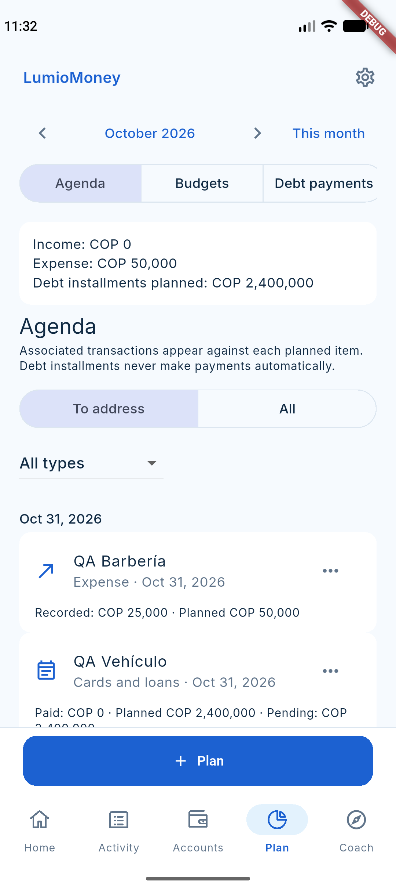

# Planning follow-up qualification — 2026-10-31

## Baseline and scope

Working-tree implementation on `main`, baseline `22bf8b4`. This qualifies the
shared attention list, typed follow-up commands, transactionally reopened
expenses, effective installment conditions, reminder planning and localized
controls. No production financial records were created, repaired or reset.

## Executed checks

| Check | Observed result |
| --- | --- |
| `flutter test --reporter json` | 474 tests passed in the final complete run; structured result `success: true` |
| `flutter analyze` | No issues after fixing E2E guard braces |
| `npm --prefix functions run build` | Passed |
| Firestore-only Emulator transaction/projection/rule/reset suites | 98 passed, zero skipped or failed |
| Debt commitment callable suite with Auth + Functions Emulator | Passed, including authenticated ownership, versioning, skip and idempotent link checks |
| Android `planning_follow_up_flow_test.dart`, `emulator-5554` | Passed complete UI flow against `demo-clearbudget` |
| Final Android E2E repetition after formatting and guard fixes | Passed again, all four flow checkpoints reached |
| QA client fresh launch and hot reload in Android Emulator | Passed; Flutter Driver health `ok`, no runtime errors |
| `flutter build apk --debug --dart-define-from-file=config/firebase.dev.android.json` | Passed; compatible debug APK built, not published to a store |
| Targeted Dart format and `git diff --check` | Passed |
| Figma | Editable Home/Coach, actions and eight state frames; dark and enlarged-text variants on `07 P0 Screens` |

The Android E2E checks partial expense completion, resume, installment dismissal
and resume, cross-month snooze, and cancellation of the last linked expense.
Financial snapshots remain identical through follow-up commands. Cancellation
reopens tracking with an explanation and restores the synthetic bank to COP
5,000,000. The synthetic loan remains COP 20,000,000; follow-up never changes it.

The E2E initially exposed missing `FirebaseFunctions` DI registration in the new
repository and fixture waits that consumed empty cache snapshots. Both were
corrected. Its final confirmation selector was also updated to the actual
`FilledButton`. These failed attempts are not counted as approved runs.

An additional screenshot-driver run stalled during native image capture and
was stopped; this does not replace or invalidate the completed functional E2E.
An independent native capture shows the synthetic mixed Agenda:



After the final E2E, the QA client was relaunched against the same Emulator and
signed into its synthetic identity. Home and Coach showed the same two entries,
including the reopened expense explanation. The hot reload succeeded, the
driver reported healthy, and no Dart runtime errors were found. The app was
returned to Home. Captures:

- [Home with reopened expense](evidence/planning-follow-ups-2026-10-31/home-reopened.png)
- [Coach with the same attention list](evidence/planning-follow-ups-2026-10-31/coach-shared-attention.png)

A combined server run passed 98/99 checks but its manually prepared legacy
migration fixture raced the running projection trigger. The appropriate
Firestore-only run passed all 98 transaction/rule checks; the callable check
was exercised separately with Functions enabled. Do not mix those environments
when interpreting migration-test results.

## Reproduction

```bash
E2E_TEST_FILE=integration_test/planning_follow_up_flow_test.dart \
  ./tool/run_emulator_e2e.sh emulator-5554
```

Use JDK 21 on `PATH`. For transaction suites run `emulators:exec --only firestore
--project demo-clearbudget` and `node --test --test-concurrency=1` with
`planning_follow_ups_test.mjs`, `projection_test.mjs`, `projection_store_test.mjs`,
`projection_audit_test.mjs`, `projection_reconciliation_test.mjs`,
`operation_commands_test.mjs`, `operation_corrections_test.mjs`,
`budget_commands_test.mjs`, `debt_commands_test.mjs`, `user_data_reset_test.mjs`
and `firestore_rules_test.mjs` under `functions/test/`.

## Publication and external checks

The requested scope is `mutatePlanningFollowUp`, `mutateOperation`,
`mutateBudget`, `mutateDebt`, `mutateDebtCommitment`, `processOperation` and
Firestore rules. No new composite indexes are needed by the introduced queries.
An initial plugin job reported success without logs; direct CLI verification
correctly detected expired credentials. After reauthentication, CLI published
the rules and updated the five existing Functions. The new callable was created
but its HTTP invoker policy was initially rejected by organization policy.
Following explicit approval for this service, `allUsersIngress=True` was applied
only to `mutateplanningfollowup`, and its `roles/run.invoker` binding was enabled
after tag propagation. No project-wide policy was broadened. The public HTTP
transport still requires Firebase Auth in the handler: an unauthenticated
request returns HTTP 401 / `planning-session-expired`.
All six Functions were subsequently read back as `ACTIVE`; the Firestore
`cloud.firestore` release was read back with its new ruleset. No composite
index or unrelated Function was deployed.

Production authenticated smoke testing was attempted using the existing QA
identity without financial writes, but signing the QA session token was denied
by `iam.serviceAccounts.signBlob`. No extra signing permission was granted.
Authenticated behavior is approved by the real app/Functions Emulator E2E;
authenticated production interaction remains a separate external check.

Reminder scheduling is covered using domain tests and the existing local-service
test doubles. Actual Android/iOS notification receipt, TalkBack/VoiceOver and a
physical-device walkthrough were not established by the Emulator E2E. Widget
coverage includes Spanish, English, Portuguese, dark mode, 320 dp and enlarged
text. The build emits an existing Kotlin plugin migration warning; it does not
prevent compiling this client. No commit, push or store submission is part of
this qualification.
